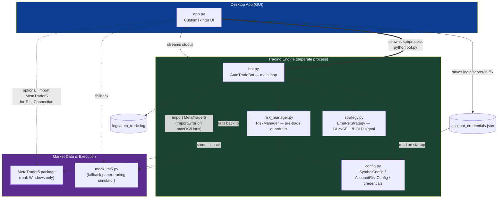

# Architecture

How `auto_trade` is put together and how a trade actually happens, end to end.

## 1. Components & how they talk to each other



**Key facts this diagram encodes:**

- **`app.py`** is a GUI you click around in. It never trades itself — it only writes `account_credentials.json` and **launches `bot.py` as a child process** (using the project's `venv` python if present), piping its console output back into the live log panel.
- **`bot.py`** is the actual trading engine. It can run completely standalone from a terminal (`python bot.py`) — the GUI is optional.
- **`config.py`** is the single source of truth for settings: it loads saved credentials, builds the two `SymbolConfig`s (`XAUUSDm` Gold, `BTCUSDm` Bitcoin) and the account-wide `AccountRiskConfig` ($10 account limits).
- **MetaTrader5 vs. `mock_mt5.py`**: everywhere the code needs the broker (`bot.py`, `risk_manager.py`, and `app.py`'s "Test Connection"), it tries `import MetaTrader5` first and silently falls back to `mock_mt5.py` if that fails (e.g. on macOS/Linux, since the real MT5 Python package is Windows-only). `mock_mt5.py` implements the same function signatures so the rest of the code doesn't know the difference — it simulates a $10 account, random-walk prices, and fills every order instantly.

## 2. What happens during one trading loop tick

```mermaid
sequenceDiagram
    participant Loop as bot.run() loop
    participant Risk as RiskManager
    participant MT5 as MetaTrader5 / mock_mt5
    participant Strat as EmaRsiStrategy
    participant Order as execute_trade()

    loop every poll_interval_seconds (default 5s)
        Loop->>Risk: check_daily_kill_switch()
        Risk->>MT5: history_deals_get() + positions_get()
        MT5-->>Risk: realized + floating PnL
        Risk-->>Loop: OK, or "kill switch active" (pause new trades)

        loop for each symbol (XAUUSDm, BTCUSDm)
            Loop->>MT5: copy_rates_from_pos() — last 100 M5 candles
            MT5-->>Loop: OHLC candle data
            Loop->>Loop: new closed candle? (skip if not)
            Loop->>Strat: evaluate(candles)
            Strat->>Strat: EMA9/EMA21 crossover + RSI14 filter
            Strat-->>Loop: BUY / SELL / HOLD + reason

            alt signal is BUY or SELL
                Loop->>Order: execute_trade(symbol, signal)
                Order->>Risk: pre_trade_approval()
                Risk->>Risk: 1) global 1-trade lock<br/>2) kill switch<br/>3) spread guard<br/>4) lot normalization<br/>5) margin/equity check
                alt approved
                    Order->>MT5: order_send(request)
                    MT5-->>Order: ticket / retcode
                    Order-->>Loop: trade executed ✅
                else rejected
                    Risk-->>Order: rejection reason
                    Order-->>Loop: trade skipped ⛔
                end
            else HOLD
                Loop->>Loop: log signal, no action
            end
        end

        Loop->>Loop: every ~60s, log account status
    end
```

**Why this shape:** the bot never acts on a half-formed candle — it only evaluates `df.iloc[-2]` (the last **closed** M5 bar) to avoid repainting signals. Every single order, no matter how confident the strategy is, still has to pass all five `RiskManager` checks — that's the capital-preservation layer built for a $10 micro account (max 1 open position account-wide, $2/day kill-switch, spread guard, margin checks, lot-size snapping).

## 3. File reference

| File | Role |
|---|---|
| [src/app.py](src/app.py) | Desktop GUI: saves credentials, starts/stops the bot subprocess, streams its logs |
| [src/bot.py](src/bot.py) | Main engine: MT5 connection, candle polling loop, order routing, logging |
| [src/config.py](src/config.py) | Credentials loading + per-symbol and account-wide risk config dataclasses |
| [src/strategy.py](src/strategy.py) | EMA 9/21 crossover + RSI 14 signal logic |
| [src/risk_manager.py](src/risk_manager.py) | Pre-trade safety gatekeeper (lock, kill-switch, spread, margin, lot size) |
| [src/mock_mt5.py](src/mock_mt5.py) | Drop-in MetaTrader5 API simulator for macOS/Linux paper trading |
| [tests/test_bot.py](tests/test_bot.py) | Unit tests for strategy + risk manager |
| `account_credentials.json` | Gitignored; written by the GUI, read by `config.py`, lives at the project root |
| [logs/auto_trade.log](logs/auto_trade.log) | Rotating log file written by `bot.py`, also at the project root |
